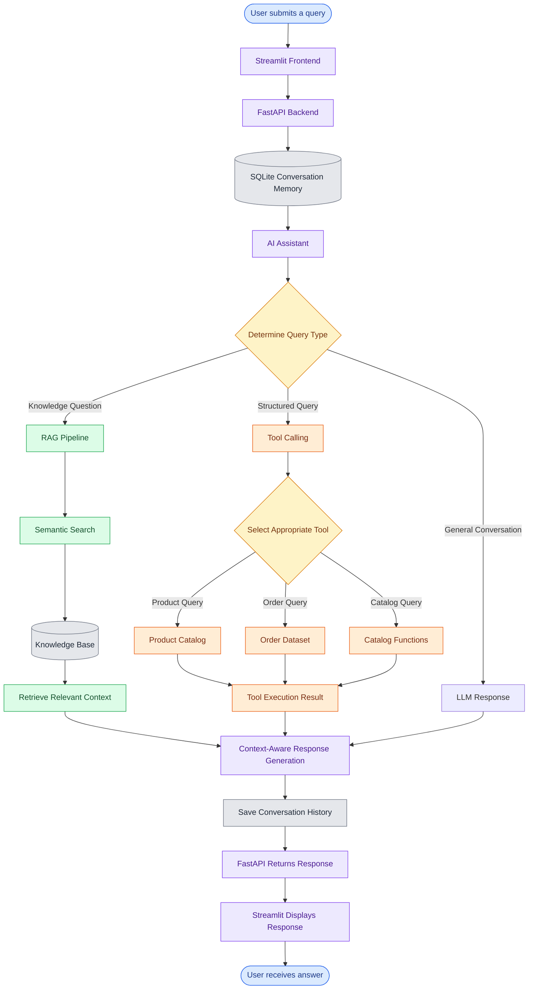
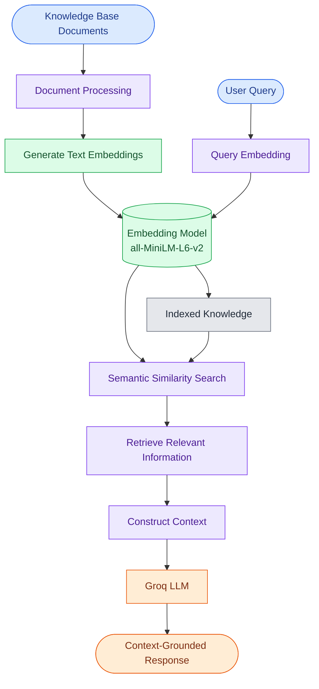
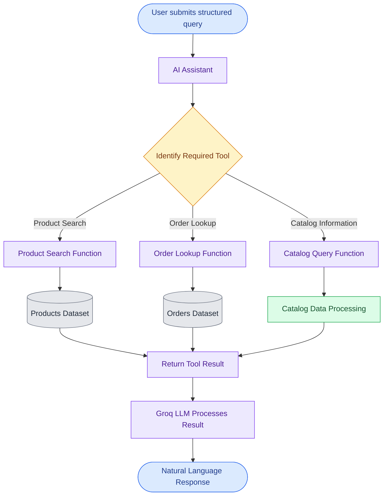

# CommerceCopilot 🛍️
### AI-Powered Shopping & Customer Support Assistant

CommerceCopilot is an AI-powered conversational shopping and customer-support assistant that combines **Retrieval-Augmented Generation (RAG), semantic search, LLM-based tool calling, and conversational memory** to handle e-commerce queries intelligently.

Built using Python, FastAPI, Streamlit, and Groq, the application enables customers to discover products, retrieve company policy information, check order details, and interact with an AI assistant through a conversational interface.

Instead of relying entirely on an LLM's pretrained knowledge, CommerceCopilot integrates a custom knowledge base and structured business data to generate context-aware responses.

---

## ✨ Key Features

- **Retrieval-Augmented Generation (RAG):** Answers customer questions using information retrieved from a custom e-commerce knowledge base.
- **Semantic Search:** Uses Sentence Transformers and `all-MiniLM-L6-v2` to generate text embeddings and retrieve semantically relevant information.
- **Intelligent Tool Calling:** Selects and executes predefined Python functions when queries require structured data.
- **Product Discovery:** Searches and filters a structured product catalog.
- **Order Information:** Retrieves order-related information from structured datasets.
- **Catalog Insights:** Handles queries involving product availability and catalog information.
- **Conversational Memory:** Maintains context across multiple messages.
- **Persistent Chat History:** Uses SQLite to store conversations across application restarts.
- **Domain Restriction:** Handles shopping and customer-support-related queries while restricting unrelated requests.
- **Interactive Chat Interface:** Provides a conversational frontend using Streamlit.
- **REST API:** Connects the frontend and AI assistant through FastAPI.

---

## 🏗️ System Architecture

CommerceCopilot follows a modular architecture that separates user interaction, backend processing, knowledge retrieval, structured tool execution, and conversation persistence.

### 1. Application Flowchart

The following flowchart illustrates the complete query-processing workflow, from user input to response generation.



### 2. RAG Pipeline

CommerceCopilot uses a custom knowledge base containing e-commerce information, including:

- Return policies
- Delivery policies
- Frequently asked questions

The embedding model converts text into numerical representations, allowing the system to retrieve relevant information based on semantic similarity.



### 3. Tool Calling Workflow

Not every customer query requires document retrieval. For structured queries, the assistant invokes predefined Python functions to access the appropriate data source.



---

## 🧠 AI Models and Technologies

| Component | Technology | Purpose |
|---|---|---|
| LLM Provider | Groq | Natural-language understanding and response generation |
| Embedding Model | `all-MiniLM-L6-v2` | Semantic text embeddings |
| Embedding Framework | Sentence Transformers | Embedding generation |
| Retrieval Approach | RAG | Knowledge-grounded question answering |

### Application Tech Stack

| Technology | Purpose |
|---|---|
| Python | Core application development |
| FastAPI | Backend REST API |
| Streamlit | Interactive frontend |
| SQLite | Persistent conversation storage |
| Pandas | Structured data processing |
| Mermaid | Architecture and workflow diagrams |

---

## 💬 Conversational Memory

CommerceCopilot supports multi-turn conversations by maintaining contextual information from previous messages.

**Example interaction:**

**User:** Show me some headphones.

**Assistant:** Displays matching products from the product catalog.

**User:** Which one is the cheapest?

**Assistant:** Uses the previous conversational context to identify the cheapest option.

Conversation history is persisted using SQLite, allowing conversations to remain available across application restarts.

---

## 📁 Project Structure

```text
CommerceCopilot/
│
├── frontend/
│   └── app.py
│
├── src/
│   ├── api/
│   │   └── main.py
│   │
│   ├── memory/
│   │   └── chat_memory.py
│   │
│   ├── rag/
│   │   ├── rag_pipeline.py
│   │   └── semantic_search.py
│   │
│   ├── tools/
│   │   ├── tool_calling.py
│   │   └── tools.py
│   │
│   └── prepare_data.py
│
├── data/
│   ├── products.csv
│   ├── orders.csv
│   │
│   └── knowledge_base/
│       ├── delivery_policy.md
│       ├── faq.md
│       └── return_policy.md
│
├── test_tool_calling.py
├── test_tools.py
│
├── requirements.txt
└── README.md
```

---

## 🚀 Installation and Setup

### Prerequisites

- Python 3.10 or later
- Groq API key
- Git

### 1. Clone the Repository

```bash
git clone https://github.com/funcoderror/CommerceCopilot.git

cd CommerceCopilot
```

### 2. Create a Virtual Environment

```bash
python -m venv venv
```

Activate the environment:

**Windows:**

```bash
venv\Scripts\activate
```

**Linux / macOS:**

```bash
source venv/bin/activate
```

### 3. Install Dependencies

```bash
pip install -r requirements.txt
```

### 4. Configure Groq API Credentials

Obtain an API key from [Groq Console](https://console.groq.com/).

Configure the API key using the environment variable or configuration mechanism expected by the application.

Keep API credentials private. Never commit API keys to GitHub.

### 5. Prepare the Data

Ensure that the product catalog, order dataset, and knowledge-base documents are available in the `data/` directory.

Run the data preparation step if required by the application:

```bash
python -m src.prepare_data
```

### 6. Start the FastAPI Backend

```bash
uvicorn src.api.main:app --reload
```

The backend will be available at:

```text
http://127.0.0.1:8000
```

### 7. Start the Streamlit Frontend

Open another terminal, activate the virtual environment, and run:

```bash
streamlit run frontend/app.py
```

Open the application in your browser:

```text
http://localhost:8501
```

---

## 🧪 Testing

The project includes tests for structured tools and tool-calling functionality.

Execute the test suite using:

```bash
python -m pytest test_tools.py test_tool_calling.py
```

### Tested Functionality

- Product search and structured catalog queries.
- Order-related tool execution.
- Retrieval-based responses using the knowledge base.
- Handling of unrelated queries.
- Tool selection based on user intent.
- Multi-turn conversational context.
- Persistent conversation history.
- Frontend-to-backend communication.

The application was tested through its major shopping and customer-support workflows, including verification of conversation persistence across application restarts.

---

## 📸 Application Screenshots

Screenshots of the working application can be added here.

Suggested screenshots:

1. Main Streamlit chat interface.
2. Product search response.
3. RAG-based return or delivery policy response.
4. Order status lookup.
5. Multi-turn conversation demonstrating conversational memory.

---

## ⚠️ Limitations

- Product and order information is based on locally available datasets rather than a live e-commerce database.
- The knowledge base contains a limited collection of sample company documents.
- Response accuracy depends on the quality of retrieved information and the underlying LLM.
- The application is a functional prototype and does not implement a complete e-commerce checkout or payment system.
- External production integrations and live inventory synchronization are not currently included.

---

## 🔮 Future Improvements

- Integration with live product inventory and order-management systems.
- Improved retrieval quality through experimentation with embedding models and retrieval strategies.
- More advanced product recommendation capabilities.
- User authentication and individual customer sessions.
- Cloud deployment and production monitoring.
- Expanded evaluation using a larger collection of representative customer queries.

---

## 🎯 Project Objective

CommerceCopilot demonstrates the practical integration of **Retrieval-Augmented Generation, semantic search, LLM-based tool calling, and conversational memory** into an intelligent e-commerce assistant.

The project explores how LLM capabilities can be combined with structured business data and domain-specific knowledge to address practical shopping and customer-support requirements.

---

## 👨‍💻 Author

**Daksh Jha**

GitHub: [@funcoderror](https://github.com/funcoderror)

Project Repository: [CommerceCopilot](https://github.com/funcoderror/CommerceCopilot)

---

*CommerceCopilot — Making conversational commerce smarter with AI.*
